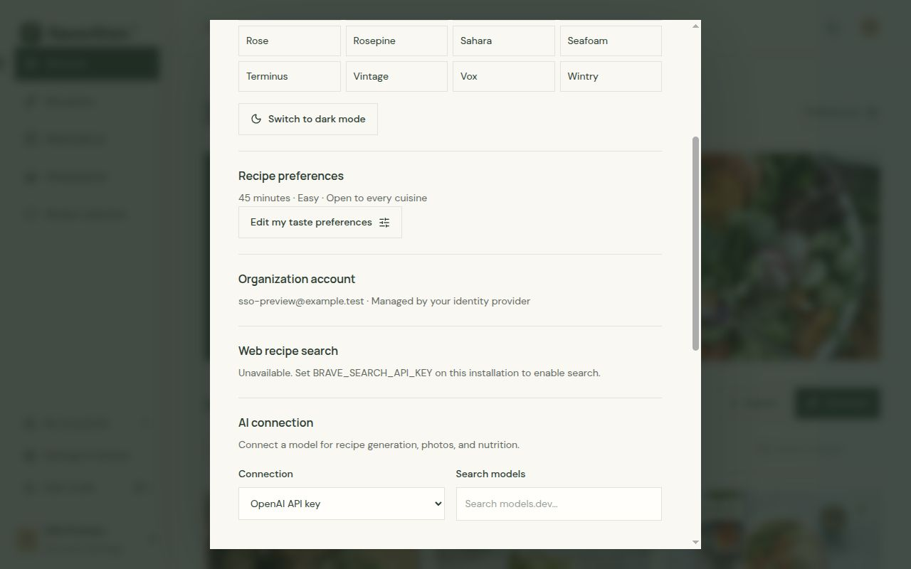

# Single sign-on and trusted proxy authentication



Flavorithm supports three server-selected authentication modes. `local` is the
default and keeps the existing email-and-password accounts. `oidc` uses an
OpenID Connect provider directly. `proxy` trusts a reverse proxy or forward-auth
gateway to authenticate the user and pass verified identity headers. Users do
not choose an authentication mode inside Flavorithm.

For a hosted deployment, use OIDC when the identity provider supports it. OIDC
is the standard authentication protocol supported by this integration and works
with providers that expose a valid discovery document. A provider that only
offers SAML needs a broker to expose OIDC, or a trusted authentication proxy
that can pass its verified identity to Flavorithm. Flavorithm does not implement
native SAML. For example, Authentik can connect to an upstream SAML IdP as a
[SAML source](https://docs.goauthentik.io/users-sources/sources/protocols/saml/)
and expose its own OIDC provider to Flavorithm. Use proxy mode when an existing
authentication gateway protects the application and can securely provide
identity headers.

## OpenID Connect

Put Flavorithm on its own public subdomain, for example
`https://flavorithm.example.com`, and keep the identity provider on its own
public URL, for example `https://authentik.example.com`. Set the public
application origin before configuring the provider. Production deployments
must use HTTPS. `ORIGIN` is the origin users visit, with no path or trailing
slash. The callback is `${ORIGIN}/auth/callback`. If
`FLAVORITHM_OIDC_REDIRECT_URI` is set, it must exactly equal that callback URL.
Register that URL at the identity provider.

Create an OIDC client at the provider using the Authorization Code flow.
Flavorithm uses PKCE and requests the `openid`, `profile`, and `email` scopes.
Copy the provider's
issuer URL, client ID, and (for a confidential client) client secret into the
server environment:

```dotenv
ORIGIN=https://flavorithm.example.com
FLAVORITHM_AUTH_MODE=oidc
FLAVORITHM_OIDC_ISSUER=https://identity.example.com/issuer/
FLAVORITHM_OIDC_CLIENT_ID=flavorithm
FLAVORITHM_OIDC_CLIENT_SECRET=replace-with-provider-secret
# Optional; defaults to post when a secret is set and none otherwise.
# FLAVORITHM_OIDC_CLIENT_AUTH_METHOD=post
# Optional; defaults to https://flavorithm.example.com/auth/callback
# FLAVORITHM_OIDC_REDIRECT_URI=https://flavorithm.example.com/auth/callback
```

Set `FLAVORITHM_OIDC_CLIENT_AUTH_METHOD` to `basic`, `post`, or `none` to
match the provider's token-endpoint client authentication registration. The
default is `post` when a client secret is set and `none` when it is not. A
confidential client secret must remain on the server.

The issuer setting is the issuer identifier, not the discovery-document URL.
The application discovers provider metadata from the issuer and validates that
the returned issuer matches. This follows the [`openid-client` discovery
guidance](https://github.com/panva/openid-client/blob/main/docs/functions/discovery.md)
to configure discovery with the issuer identifier. Keep the provider's
discovery and signing-key endpoints reachable from the Flavorithm server.

For Authentik, create an Application with an OAuth2/OpenID Provider, enable the
Authorization Code grant, and add the exact Flavorithm callback to the
provider's allowed Redirect URIs. Keep Authentik's default per-provider issuer
mode. Its issuer has the form
`https://authentik.example.com/application/o/<application-slug>/`; use the
issuer value shown for the provider, including the trailing slash. Authentik
serves that provider's discovery document under the same application path.
Select a signing key backed by an RSA certificate so ID tokens use RS256 and
can be verified through the provider's JWKS endpoint. With no signing key,
Authentik uses HS256 with the client secret and does not publish that signing
key in JWKS. Keep discovery and JWKS endpoints reachable from Flavorithm.
See Authentik's [OAuth 2.0 provider guide](https://docs.goauthentik.io/add-secure-apps/providers/oauth2/)
for issuer modes, endpoints, redirect URI settings, and signing keys.

Use a stable provider subject as the account identity. Flavorithm maps an
account by the pair `(issuer, subject)`. On the first successful OIDC sign-in,
the app creates a passwordless account, household, and starter state. Email is
required as a profile attribute, but Flavorithm does not automatically link a
new OIDC identity to a local account just because the email addresses match. A
collision returns a generic error and leaves the existing account untouched.
Preserve the provider and subject for each user when changing IdPs or issuer
configuration.

`FLAVORITHM_OIDC_SESSION_TTL_SECONDS` sets the maximum local application-session
lifetime. It defaults to one hour and accepts values from 300 to 86400 seconds;
the session also expires with the ID token if that happens sooner. The identity
provider's own browser session has its own lifetime and policy.

## Trusted reverse-proxy authentication

Use proxy mode only when a reverse proxy or authentication gateway is the
exclusive public path to Flavorithm. The gateway must authenticate each request,
replace any client-supplied identity headers with the provider's verified
values, and add a server-side shared-secret header. Keep the app upstream
private to that gateway and protect the shared secret as a credential.

Set `FLAVORITHM_AUTH_MODE=proxy` and a random secret of at least 32 bytes,
known only to Flavorithm and the trusted reverse proxy:

```dotenv
FLAVORITHM_AUTH_MODE=proxy
FLAVORITHM_PROXY_SHARED_SECRET=replace-with-a-long-random-secret
```

Generate a secret privately, for example with `openssl rand -hex 32`. The
default secret header is `x-flavorithm-proxy-secret`. The defaults for the
identity headers match Authentik's proxy outpost:

| Setting             | Environment variable              | Default or example header   |
| ------------------- | --------------------------------- | --------------------------- |
| Shared secret       | `FLAVORITHM_PROXY_SECRET_HEADER`  | `x-flavorithm-proxy-secret` |
| Stable user subject | `FLAVORITHM_PROXY_SUBJECT_HEADER` | `x-authentik-uid`           |
| User email          | `FLAVORITHM_PROXY_EMAIL_HEADER`   | `x-authentik-email`         |
| Display name        | `FLAVORITHM_PROXY_NAME_HEADER`    | `x-authentik-name`          |

Header names are configurable for other gateways. Map their stable user
identifier to the subject header, and map the authenticated email and name to
their corresponding headers. Proxy identities use the pair `(issuer, subject)`
just like OIDC identities. A first authenticated request creates a passwordless
account, household, and starter kitchen. Email does not link the proxy identity
to an existing local account. The default identity namespace is
`flavorithm:proxy`; set `FLAVORITHM_PROXY_ISSUER` to another stable value if you
need to distinguish a different gateway or tenant. Do not use email as the
subject when the provider supplies a stable user ID.

### Authentik forward auth

In Authentik, create an Application and a Proxy Provider in **Forward auth
(single application)** mode for the Flavorithm public URL. Assign it to an
embedded or managed Proxy outpost. Configure the reverse proxy to send
authentication checks to the outpost, route `/outpost.goauthentik.io` to that
outpost, and send authorized application traffic to Flavorithm. The outpost
path must remain reachable without the forward-auth check. Add the shared
secret header at the reverse proxy after authentication, and overwrite or
remove client-supplied `X-Authentik-*` identity headers before forwarding to
Flavorithm.

Authentik's single-application mode gives the app its own provider and access
policies. Domain-level mode can cover multiple apps under one parent domain,
but Authentik notes that it cannot apply separate application-level policies
to each protected app. Choose the mode that matches your access rules and use
the matching reverse-proxy template in the
[Authentik forward-auth guide](https://docs.goauthentik.io/add-secure-apps/providers/proxy/forward_auth)
and [proxy-provider guide](https://docs.goauthentik.io/add-secure-apps/providers/proxy/).

### Authelia, oauth2-proxy, and other gateways

Configure the gateway's forward-auth integration to pass its authenticated
identity to the upstream. Map a stable user ID, verified email, and display
name to the subject, email, and name headers configured for Flavorithm. Have
the reverse proxy add the shared-secret header itself; do not accept that value
from the browser. If the gateway cannot pass a stable identity or the proxy
cannot overwrite incoming identity headers, use OIDC instead.

## Sessions and logout

Flavorithm logout revokes the application's local OIDC session and redirects to
the provider's discovered `end_session_endpoint` when available, with the
configured post-logout URI. The provider may keep its own browser session, so a
later sign-in can return without asking for credentials until that session
expires or is separately ended. The application does not continuously poll the
provider for account revocation and does not process provider-initiated
back-channel logout. Provider-side disablement can block new authentication,
but it does not revoke an existing local session; that session remains valid
until its local timeout or the user signs out.

In proxy mode, identity is checked from the authenticated request headers on
each request. Flavorithm's short-lived binding cookie is not an identity
credential. Logging out of Flavorithm does not end the session at the proxy
or identity provider by itself. Set `FLAVORITHM_PROXY_LOGOUT_URL` to the
gateway's logout URL to show a useful sign-out action and redirect users there
after the Flavorithm binding cookie is cleared. Without that setting, the app
hides its sign-out action; calling `/auth/logout` directly clears the binding
cookie, but the next proxied request can authenticate the user again. For
Authentik single-application forward auth, its documented logout URL is
`https://flavorithm.example.com/outpost.goauthentik.io/sign_out`; for
domain-level forward auth, use the authentication URL configured for the
provider. Use the gateway's own logout flow to end that session as well. See
Authentik's [proxy logout instructions](https://docs.goauthentik.io/add-secure-apps/providers/proxy/)
for the mode-specific host.

## Readiness

Run `npm run readiness` after setting the production environment. It checks
that the selected authentication mode has the required configuration without
printing credentials. It does not contact the identity provider, validate a
real login, or prove that the reverse proxy strips spoofed headers. Follow the
SSO checks in the [launch checklist](launch-checklist.md) from a real browser
and through the public proxy.
